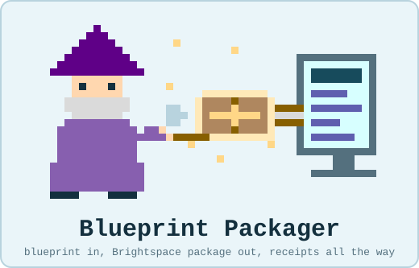

# Blueprint Packager

<p align="center">
  
</p>

Blueprint Packager turns a course blueprint, a Word document written in a
small, fixed layout, into a Brightspace (D2L) import package: modules, pages,
assignment folders, discussions, checklists, quizzes, rubrics, grade items,
due dates, and the links between them. It works in inspectable stages, writes
a receipt at every one, accounts for source content, and reads its own package
back to check the supported content and relationships before operator review.

In short: write the blueprint in Word, run the packager, import the ZIP.
Nothing here talks to Brightspace; you import the package yourself, and your
documents never leave your machine. Start with
[Guided install and run](#guided-install-and-run).

---

## Contents

1. [Who this is for](#who-this-is-for)
2. [The idea in one picture](#the-idea-in-one-picture)
3. [What you need](#what-you-need)
4. [Guided install and run](#guided-install-and-run)
5. [Quick start on the command line](#quick-start-on-the-command-line)
6. [How it works](#how-it-works)
7. [What a build produces](#what-a-build-produces)
8. [Importing, and updating a course later](#importing-and-updating-a-course-later)
9. [Writing a blueprint](#writing-a-blueprint)
10. [Page styling](#page-styling)
11. [Status, evidence and provenance](#status-evidence-and-provenance)
12. [Releases, updates and repair](#releases-updates-and-repair)
13. [The vendored engine](#the-vendored-engine)
14. [Forking, syncing, and contributing](#forking-syncing-and-contributing)
15. [License](#license)
16. [Repository map](#repository-map)
17. [Questions and changes](#questions-and-changes)

---

## Who this is for

- **Instructional designers and course builders** who write or receive a
  course blueprint and want a Brightspace course from it without rebuilding
  it by hand, page by page and folder by folder.
- **Subject-matter experts** who only ever touch the Word document. The
  blueprint is the whole interface; nothing here needs to be run by them.
- **Anyone checking a build** before import. Every run leaves a readable
  report of what it did and what it found.

You do not need access to any other repository to use this one. The engine
scripts the packager builds with are included here, pinned to a named
version (see [The vendored engine](#the-vendored-engine)).

## The idea in one picture

```
   Word blueprint  ──►  Blueprint Packager  ──►  Brightspace package (.zip)  ──►  import
   (SME + designer)      normalize · read ·        + receipts, object map,
                         build · verify            page-refresh zip, runbook

   Brightspace export  ──►  Blueprint Wizard JSON bundle
                                      │
                              from-wizard adapter
                                      │
                              Authoring DOCX + ledger
```

The adapter supports an explicit subset of extracted course structures and
stops when a conversion would discard unsupported content or settings.

## What you need

- **Python 3.11 or later** and the packages in `requirements.txt`.
- **A blueprint** in the packager's layout. Start one with `bpk.py blank`
  (below), convert a Blueprint Wizard extraction bundle with `from-wizard`, or
  convert an existing document with a course map (see
  [How it works](#how-it-works)).
- **A Brightspace course to import into**, ideally an empty sandbox for the
  first round. Importing needs the course's Import/Export/Copy Components
  permission; nothing here talks to Brightspace directly.

## Guided install and run

The guided runner does the setup and walks through a build in one terminal
window. There is nothing else to install by hand: on first run it asks before
creating a private `.venv` inside its folder and installing its packages
there. Your blueprint and your package never leave your machine.

**Download and start.** The repository is public and nothing here needs an
account: the one-command installer fetches the latest release (through `gh`
when it is signed in, otherwise anonymously, checking the published SHA-256),
and the runner's update check reads the release the same way.

| Platform | Install | Start later |
|---|---|---|
| macOS | `bash install_blueprint_packager.sh` (or unzip a release and double-click **Blueprint Packager.command**; if macOS warns about an unidentified developer the first time, right-click it and choose Open) | double-click **Blueprint Packager.command** |
| Windows | `powershell -NoProfile -ExecutionPolicy Bypass -File install_blueprint_packager.ps1` (or unzip a release and double-click **Blueprint Packager.bat**) | double-click **Blueprint Packager.bat** |
| Linux | `bash install_blueprint_packager.sh` | `bash blueprint_packager.sh` |

The installer puts the latest release in `./blueprint-packager/` (or a folder
you name), writes a pointer the launchers read, and starts the runner.
Running it again installs a newer release beside the old one; nothing is
deleted, and the old folder's launcher forwards to the current version.

**What the runner walks through.** Each phase has a line of context and a
`· n of N ·` marker so you know where you are.

1. **Splash.** The wizard delivers a package into a monitor. Any key skips it.
2. **The workshop.** Python 3.11 or later, the private environment, the
   Python packages, and the vendored engine's integrity: every file in its
   manifest present with the recorded hash. A missing package is offered as
   an install, with a question first. Vendored files are only reported,
   never changed. Then a quiet, once-a-day check for a newer release.
3. **The task.** A numbered menu with a sentence each: first time here
   (a blank blueprint, opened for you), build a package (read, build, verify
   in one go, the usual path), a dry run that reads and reports without
   building, verify an existing build folder, re-sync a course map after
   the document changed, or check for updates. When a blueprint was built
   before, the runner offers to build it again with the same answers.
4. **The commission.** The inputs the task needs. Drag a file into the
   window instead of typing its path; the runner looks inside and shows the
   title and the number of weeks before you commit to it. Build settings
   can be an existing file (drag it in), the last one used, or made for
   you from a few questions: package title, the course label above each
   page title, a manifest identifier, the page template, and an optional
   term calendar from the first day of Week 1 and a week count. Review the
   displayed week boundaries and edit partial weeks, breaks, or the final
   week before accepting that calendar. Answers
   are remembered in `.last_run.json`, and a summary card can be edited by
   number before anything runs.
5. **The build.** The stages run one after another with their output
   dimmed beneath and the time each took. Verification shows its applicable
   checks as a live checklist. The first stage that fails stops the run and
   shows its last lines and the log.
6. **The results.** A card with the ZIP and its SHA-256, the pages-refresh
   ZIP, the object map, the verification report with its pass count, and a
   "What to do next" card. A ready package proceeds to operator review of the
   verification evidence before any import into an empty course; a draft preview
   reports its unfinished fields. Re-import duplicates objects, while page text
   can be refreshed through Manage Files. Then an offer to open the folder.

Every run writes a log under `logs/`. Ctrl-C cancels cleanly. Flags:
`--plain` (no colour, art, or animation; also automatic when output is not a
terminal or `NO_COLOR` is set), `--yes` (accept the remembered answers and run
without prompts, for repeat builds), `--task build --blueprint …` and the
other inputs as flags for scripted use, `--doctor` (check the setup only),
`--check-for-updates`, `--no-update-check` or `BPK_NO_UPDATE_CHECK=1`. See
`INSTALL_AND_TROUBLESHOOT.md` when something does not start.

**Updates.** Once a day, when GitHub is reachable, the runner compares the
installed version with the latest release and says when a newer one exists,
with the one command that installs it beside this version and restarts.
Nothing is deleted. After an update, build from the blueprint again; the
runner re-reads it. Details, including repair of a damaged install, are in
[Releases, updates and repair](#releases-updates-and-repair).

## Quick start on the command line

```bash
# once
python3 -m venv .venv && . .venv/bin/activate && pip install -r requirements.txt

# 1. a minimal blank to fill in; Week 2 has two assignments and one discussion
python3 bpk.py blank MY_COURSE.docx --course-number "NEW 101" --course-title "Course Title" \
        --term "Spring A 2027" --weeks 8 --week-count 2:2:1

# 2. read the filled-in blueprint into a course model (reports every problem it finds)
python3 bpk.py read MY_COURSE.docx --output-dir out --label my_course

# 3. build the package (settings: template, calendar, grade item names, and so on)
python3 bpk.py build out/my_course__course_model.json --settings build_settings.json \
        --output-dir build --force

# 4. read the package back and compare the evidence with the model
python3 bpk.py verify build --model out/my_course__course_model.json
```

Review the readiness and verification reports before an operator imports
`build/<package>.zip` into Brightspace as a course package. The
build folder's `object_map.md` says what to expect to find, and a course's
own runbook, when it supplies one, says what to check by eye.

Exit codes: 0 success; 1 the step ran and found errors; 2 usage or refusal;
130 interrupted.

The blank is an authoring draft. Replace its plain writing prompts in full
before a normal build. Use `--worked-example` when generating a separate
example with panels and sample rubrics. Set `--assignments-per-week` and
`--discussions-per-week` for common counts; repeat `--week-count W:A:D` for
weekly overrides, including zero. Existing blank destinations are protected;
an explicit `blank --force` backs up the existing document before replacing it.

A generated [eight-week blank](docs/examples/blank_blueprint__8_weeks__ux_review.docx)
shows the layout, and the [design review](docs/DESIGN_REVIEW_2026-10-09.md)
records how designers and subject-matter experts read it. Optional design
tokens and connection shortcuts can be left for manual completion in
Brightspace; the
[authoring guide](docs/AUTHORING_GUIDE.md#optional-features-and-manual-completion-in-brightspace)
explains how to remove unused declarations and record the remaining work.

To inspect unfinished output, add `--preview` to `build`. A preview permits
pending authoring fields and is labelled as a draft; structural errors and
unaccounted source content still stop the build. An intentional video placeholder
or link fallback can be retained by its exact title using
`--retain-video-placeholder TITLE` or `--video-link-fallback TITLE`.


## How it works

Each stage reads the previous stage's output and writes its own, so a problem
can be found where it happened.

| Stage | Command | What it does |
|---|---|---|
| Blank | `bpk.py blank` | Writes a minimal authoring draft with configurable weekly activity counts and visible writing areas; worked examples are optional. |
| Wizard conversion | `bpk.py from-wizard` | Converts a supported immutable extraction bundle into an authoring DOCX with source hashes, dispositions, and unresolved diagnostics. |
| Ingest | `bpk.py ingest` | Dumps a Word file as a stream of paragraphs with stable ids, the ids every later record refers to. |
| Normalize | `bpk.py normalize` | For a document not yet in the layout: applies a **course map** of structural decisions (move, restyle, mark a panel, make a list, carry a title into a line) and writes a normalized copy. A fidelity proof shows every authored word is still there. Wording changes happen only as recorded entries that name who authorized them and why. |
| Read | `bpk.py read` | Writes the course model, source-accounting ledger, readiness report, relationship report, and diagnostics. Unknown or unplaced authored content is blocking. |
| Rename | `bpk.py rename` | Previews an exact activity rename and its structural references; `--apply` writes an authorized new copy and ledger. |
| Build | `bpk.py build` | Writes the Brightspace package from the model and a settings file: page HTML from a template, activity descriptions, dates from a term calendar and due-day rules, checklists built from each week's activities, grade items, rubrics. Deterministic: the same inputs give a byte-identical ZIP. |
| Verify | `bpk.py verify` | Checks source accounting, authored content, link text/targets, structure, joins, points, rubrics, checklists, applicable dates, page conformance, and Wizard QA evidence. Missing evidence is not a pass. |
| Re-sync | `bpk.py rebase-map` | When the source document changes, carries a course map from the old export to the new one and reports what moved, was added, or was removed. |

A blueprint written in the layout from the start skips Normalize.

**Coming from a Brightspace export.** The Blueprint Wizard, a separate tool,
extracts an existing Brightspace course into an immutable JSON bundle.
`bpk.py from-wizard` converts a supported bundle into an editable Packager
blueprint with source hashes and a ledger of what it did; the Wizard's own
review DOCX is not interchangeable with the authoring DOCX. The adapter
checks exact identities and refuses to convert evidence it does not support;
see the [supported conversion shapes](docs/WIZARD_AUTHORING_CONVERSION.md)
and the [conversion backlog](docs/CONVERSION_BACKLOG_2026-10-13.md).

## What a build produces

| File | What it is for |
|---|---|
| `<package>.zip` | The Brightspace course package. Import this. |
| `package/` | The same package unzipped, for inspection. |
| `course_pages_refresh.zip` | Just the HTML pages. Uploading its folder through Manage Files refreshes page content in a course that is already built, with no new objects (see the next section). |
| `object_map.json`, `object_map.md` | Every object the build made, its resource code, its placement, its dates, which paragraphs went where, and every build note. |
| `component_package_receipt.json` | The receipt: what was read (with hashes), what was written, which engine files were used, which engine commit they came from. |
| `verification_report.md`, `.json` | Read-back checks and their evidence, including failed or unavailable checks. |
| `build_settings.json` | A copy of the settings the build used. |

Every page's HTML opens with a one-line comment naming the tool version, the
package, the blueprint file and its hash, and the template, so a page found
in a course can be traced to the build that made it.

## Importing, and updating a course later

The named MBA 620 sandbox rounds established the following behaviour for the
tested packages. They do not certify every future package or tenant.

- **First import into an empty course:** the tested package's objects arrived,
  and its re-export matched the expected content and structure under the
  documented date/quotation normalization.
- **Importing the same package again into a course that already holds it
  duplicates every object** except the HTML pages: modules, folders, forums,
  checklists, quizzes, rubrics, and grade items all double, and the new
  activities are left without grade items. Brightspace does not match
  objects by the package's identities. So a built course is updated by
  deleting the built content first and importing again.
- **Page text alone can be refreshed in place.** Pages are course files and
  Brightspace overwrites a file at the same path. Upload the folder inside
  `course_pages_refresh.zip` through Manage Files; every page updates, and
  nothing else changes.
- **A reused course mints fresh resource codes** even after the old objects
  are deleted. Nothing in the tool depends on the codes coming back; they are
  for the records.

The receipts behind these statements are in `docs/IMPORT_RECEIPTS.md`.

## Writing a blueprint

The full rules are in [`docs/AUTHORING_GUIDE.md`](docs/AUTHORING_GUIDE.md).
The ones that matter most:

- **Headings are one to one with the page.** The blueprint's frame (Course
  Introduction, Before Week 1, each week, Rubric Appendix) is Heading 1. The
  page title is its own line. Content inside a page starts at Heading 2 and
  keeps its level on the page: Heading 2 is h2, Heading 3 is h3.
- **Panels are bracket lines.** `[dropdown: Title]` … `[/dropdown]`,
  `[callout]` … `[/callout]`, `[callout tone=gold]` for something to keep in
  mind, `[timeline]`, `[box]`. Nothing depends on shading, which does not
  survive editing.
- **Links to the course's own objects** are `[link to assignment: Title |
  words]`, `[link to page: Title]`, and so on. The build turns them into
  working links; an unknown target is left visible as an error.
- **Every week has the same six rows:** Overview, Learning Objectives,
  Assigned Reading and Multimedia, Assignments, Discussions, Checklist. A
  checklist can list its items or carry one line, `Items: From this week's
  activities`, and the build makes the list.
- **A week may contain multiple activities.** Each assignment or discussion is
  a complete declaration-and-instructions block within its appropriate row.
  Counts may differ by week. Update its grading row and rubric references when
  adding or removing an activity; the relationship report identifies them.
- **Writing areas are explicit.** Replace a prompt such as “Write the assignment
  instructions here.” with ordinary paragraphs. `Author note:` paragraphs and
  the final `Authoring reference` section stay out of learner content. Older
  bracketed guidance and placeholder forms remain supported.
- **Video brackets:** `[video: Title | URL]` produces a supported player;
  `[video placeholder: Title]` produces a visible placeholder in preview or
  after explicit retention. The title becomes the iframe's accessible label.
- **Term dates come from settings.** The blueprint can say "due Sunday"; the build
  settings carry the term's week table and the program's due-day rules.
- **Activities say what they are** on one line (`Assignment: Week 2
  Deliverable: …`, `Points: 10 pts`, `Rubric: …`), and the points table at
  the front of the document must agree. The build stops on a disagreement
  until someone records which is right.

Real bullets, real numbering, bold and italic all come through as typed.

A blueprint can be written in Google Docs and exported as Word. A live check
in October 2026 covered native upload, pageless mode, editing, Word export,
and the guided runner on draft and ready synthetic courses; the
[Google authoring QA record](docs/evidence/GOOGLE_AUTHORING_QA_2026-10-09.md)
has the comparisons and the limits of that evidence.

## Page styling

Pages take their look from a template chosen in the build settings. The
default, `composite-navy`, is a composite of three earlier course designs:
a dark navy brand, calm spacing, arrow-marked dropdown cards, a restrained
callout with a warm tone available, and an accessibility pass (skip link,
visible keyboard focus, print rules). `bumk515-classic` reproduces an earlier
course's page style. Assignment and discussion descriptions take a modest
style set derived from the same template, or none, by setting
`fragment_styles` to `plain`. Details: [`docs/TEMPLATE_COMPOSITE_NAVY.md`](docs/TEMPLATE_COMPOSITE_NAVY.md).

## Status, evidence and provenance

**Status.** Version 0.3.1, released 2026-10-13; `CHANGELOG.md` lists every
release. The repository is public under AGPL-3.0-or-later. The MBA 620
sandbox rounds of October 2026 give the named whole-course packages L4
evidence. The authoring features new since 0.2.2 (several activities in a
week, video markers, readiness gates, the Wizard conversion, the bracket
vocabulary) have local test evidence on the CI matrix and a smoke test of
each published release, and no new tenant import round yet; see the
[implementation log](docs/IMPLEMENTATION_LOG_2026-10-09.md) and the
[conversion backlog](docs/CONVERSION_BACKLOG_2026-10-13.md).

**Evidence levels.** Every shape the tool can build is listed in
`CAPABILITIES.json` with how well it is proven, on a ladder from L1 (the tool
reads its own output back) to L4 (a package was imported into Brightspace,
re-exported, and read back). The named historical whole-course packages reached
L4 in October 2026; `docs/IMPORT_RECEIPTS.md` holds those receipts, each with the
package hash, the sandbox, the counts, and what Brightspace changed. New candidate
features retain L1/local evidence until an appropriate operator-led tenant round
is recorded. Live Google Docs conversion is separate from tenant evidence.

**What every run records.** The receipt names the producer and version, the
input file and its hash, every engine file used and its hash, the settings,
and the outputs. The object map ties every built object to the blueprint
paragraphs that fed it. Verification reports name the readers that were used.
Nothing is edited by hand after a build; a change means a rebuild.

**The engine, pinned.** The package-writing and read-back scripts come from
CourseCraft Workbench, a separate repository maintained by this tool's
author. The files the packager needs are copied here at one named commit,
with every file's hash recorded, and that commit is written into every
receipt and verification report, so a build can always be tied to the exact
engine that made it. How that works, and how to update it, is in
[The vendored engine](#the-vendored-engine).

**Wording.** The tool never changes authored text on its own. A course map
may carry authorized edits, each with who authorized it and why, and the
fidelity proof and the build records list every one apart from the authored
text.

**Records.** `docs/records/` holds the survey reports and work records the
tool was designed from, including the notes on how Brightspace behaves on
import. They are kept so decisions can be checked later, not for reading
first.

## Releases, updates and repair

Releases are cut from a verified tag and pinned to a commit. The ZIP carries a
manifest of every file's hash, the commit, the tag and the engine pin. The
installer verifies every hash before anything is put in place and leaves the
previous version where it was; the old folder's launcher forwards to the
current one. Installing a version that is already in place checks its files
and names any that differ; `--repair` restores them from the verified archive
without touching `.venv`, remembered answers or logs.

Nothing needs an account. The runner's update check and
`launcher/install_release.py --latest` read the public release anonymously;
a signed-in `gh` or a `GITHUB_TOKEN` only raises GitHub's rate limit.

After an update, build from the blueprint again. A course model cached by
0.2.2 lacks the source-accounting ledger and the current input contracts, and
`build` refuses it with "Re-read the DOCX"; re-reading never changes the
source document.

Before a release, CI runs the suite at Python 3.11 through 3.14 on Linux,
Windows and macOS, and installs, repairs and starts the release ZIP through
the real launchers on all three. After publication,
`scripts/smoke_test_release.py` tests the published asset from the download,
and its report is committed under `docs/evidence/`. `RELEASING.md` has the
steps.

## The vendored engine

The packager does not write Brightspace XML from scratch. It builds with, and
verifies against, scripts and schema files from **CourseCraft Workbench**, a
separate, private engineering repository kept by this tool's author. Those
files are *vendored*: copied into this repository so that it runs on its own,
and distributed here under this repository's license by the same author.

| Where | What |
|---|---|
| `vendor/coursecraft_workbench/scripts/` | The engine scripts: package writing (`d2l_package_lib.py`, `rubric_package_lib.py`), the independent readers the verify step runs, and the page gate. |
| `vendor/coursecraft_workbench/workspace/reference/schemas/` | The schema files those scripts load. |
| `vendor/coursecraft_workbench/MANIFEST.json` | The Workbench commit the copies came from, and each file's SHA-256. |

**Using them.** Nothing to do. `bpk.py` finds the vendored copies on its own
and records which copy a run used in the receipt. If you do have a Workbench
checkout and want a run to use it instead, pass
`--workbench-scripts /path/to/coursecraft_workbench/scripts` or set
`BPK_WORKBENCH_SCRIPTS`; the receipt will say so.

**Rules.** The vendored files are never edited in this repository. A change to
engine behaviour is made in the Workbench and brought here by re-pinning, so
the two never silently diverge. If you find a problem that lives in a
vendored file, report it (below) rather than patching the copy.

**Updating them.** The drift check compares the copies with a Workbench
checkout and, on request, replaces them from a named commit:

```bash
python3 scripts/check_vendor_drift.py /path/to/coursecraft_workbench               # report any drift
python3 scripts/check_vendor_drift.py /path/to/coursecraft_workbench --commit <sha> # re-pin from that commit
pytest -q                                                                            # then prove nothing broke
```

A re-pin updates the manifest; commit the vendored files and the manifest
together. Without Workbench access you cannot re-pin yourself, and you do not
need to: re-pins ship with this repository's releases and are listed in the
changelog.

## Forking, syncing, and contributing

If you fork this repository to build your own courses, two things to know.

- **Sync with `main` for updates.** The engine re-pins, template changes,
  and fixes land on `main` here. A fork that stays on its own branch will
  keep working, but it will not see them. Pull `main` into your fork before
  a new course build, and read `CHANGELOG.md` for what changed.
- **Contributions are welcome and appreciated.** Fixes, templates, authoring
  guide improvements, new evidence from your own sandbox imports, or a
  finding about how Brightspace behaves: open an issue or a pull request
  against `main`. Keep a change in one of three places: this repository for
  the packager's own behaviour; the Workbench for anything in a vendored file
  (say so in the issue and the author will carry it upstream and re-pin);
  your course's own repository for course maps, settings, and packages.
  Commit messages say what changed and why; no AI attribution lines.

## License

This repository is licensed under the GNU Affero General Public License,
version 3 or later (`AGPL-3.0-or-later`). See `LICENSE`. Commercial licenses,
hosted deployments, implementation support, institutional integrations and
other paid services are available by agreement; see `COMMERCIAL.md`.
`LICENSE_POSTURE.md` records when and why the pairing was selected.

## Repository map

| Path | What |
|---|---|
| `Blueprint Packager.command`, `Blueprint Packager.bat`, `blueprint_packager.sh`, `blueprint_packager.ps1` | The double-click and terminal launchers: find Python, make the private `.venv`, start the guided runner. |
| `install_blueprint_packager.sh`, `.ps1` | One-command install of the latest release into a folder, then start. |
| `scripts/packager_tui.py`, `scripts/ui.py`, `scripts/art.py` | The guided runner, its terminal components, and the splash. |
| `scripts/update_check.py`, `launcher/install_release.py` | The once-a-day release check, and the verified side-by-side installer it offers. |
| `scripts/make_release_bundle.py`, `RELEASING.md` | Cut a release ZIP from a verified tag with its manifest; the steps. |
| `scripts/smoke_test_release.py` | Smoke-test a published release from the download: hash, manifest, install, launcher, blank, ready course, Wizard cycle, shipped suite. |
| `.github/workflows/ci.yml` | The pre-release matrix: the suite at Python 3.11 to 3.14 on Linux, Windows and macOS; the release ZIP installed, repaired and started through the launchers on all three. |
| `bpk.py` | The command line. `python3 bpk.py --help` lists the stages. |
| `blueprint_packager/` | Pipeline stages plus `authoring` (readiness/media), `contracts` (input validation), `relationships` (reports/renames), and `wizard_authoring` (explicit conversion). `vocabulary` holds structural words; `workbench` resolves the pinned engine. |
| `blueprint_packager/templates/` | Page templates: `composite_navy` (default), `bumk515_classic`. |
| `vendor/coursecraft_workbench/` | The pinned engine files and schemas, with their manifest. |
| `scripts/check_vendor_drift.py` | Compares the vendored files with a Workbench checkout; re-pins on request. |
| `scripts/render_readme_art.py` | Draws the picture at the top of this page from a text grid; the splash uses the same grid. |
| `INSTALL_AND_TROUBLESHOOT.md` | When the launcher or the runner does not start. |
| `docs/AUTHORING_GUIDE.md` | How to write a blueprint. Start here if you will edit one. |
| `docs/WIZARD_AUTHORING_CONVERSION.md` | Supported extraction-to-authoring conversion shapes and limitations. |
| `docs/CONVERSION_BACKLOG_2026-10-13.md` | What each unsupported conversion family would need before it could be supported. |
| `docs/IMPLEMENTATION_PLAN_2026-10-09.md`, `docs/IMPLEMENTATION_LOG_2026-10-09.md` | Approved candidate scope, decisions, deviations, and evidence. |
| `docs/DESIGN.md` | Why the tool is shaped as it is, and the open directions. |
| `docs/IMPORT_RECEIPTS.md` | The sandbox receipts behind the evidence level. |
| `docs/TEMPLATE_COMPOSITE_NAVY.md` | The default template and where each part came from. |
| `docs/PROMOTION_MANIFEST.md` | Which parts belong to the shared engine and where that stands. |
| `docs/examples/` | A generated eight-week blank blueprint. |
| `docs/records/` | Survey reports and work records. |
| `tests/` | Synthetic fixtures end to end; `.venv/bin/python -m pytest tests -q`. The update test needs the previous release's tag in the checkout. |
| `LICENSE`, `COMMERCIAL.md`, `LICENSE_POSTURE.md` | AGPL-3.0-or-later, the commercial terms note, and the record of the selection. |
| `CAPABILITIES.json`, `CHANGELOG.md`, `ROADMAP.md`, `AGENTS.md` | What it builds and how well, what changed, what is next, what it must never do. |

## Questions and changes

- Something in a build looks wrong: open the build's `verification_report.md`
  and `object_map.md` first; they say what was read and what was checked.
- A blueprint will not read: the diagnostics name the paragraph and say what
  to change. The authoring guide explains structural rules, readiness, and
  unsupported content.
- A problem in a vendored file: report it; it is fixed in the Workbench and
  re-pinned here, never patched in place. `AGENTS.md` says what this
  repository owns.
- Dependencies: `python-docx`, `lxml`, `openpyxl`, `jsonschema`.
